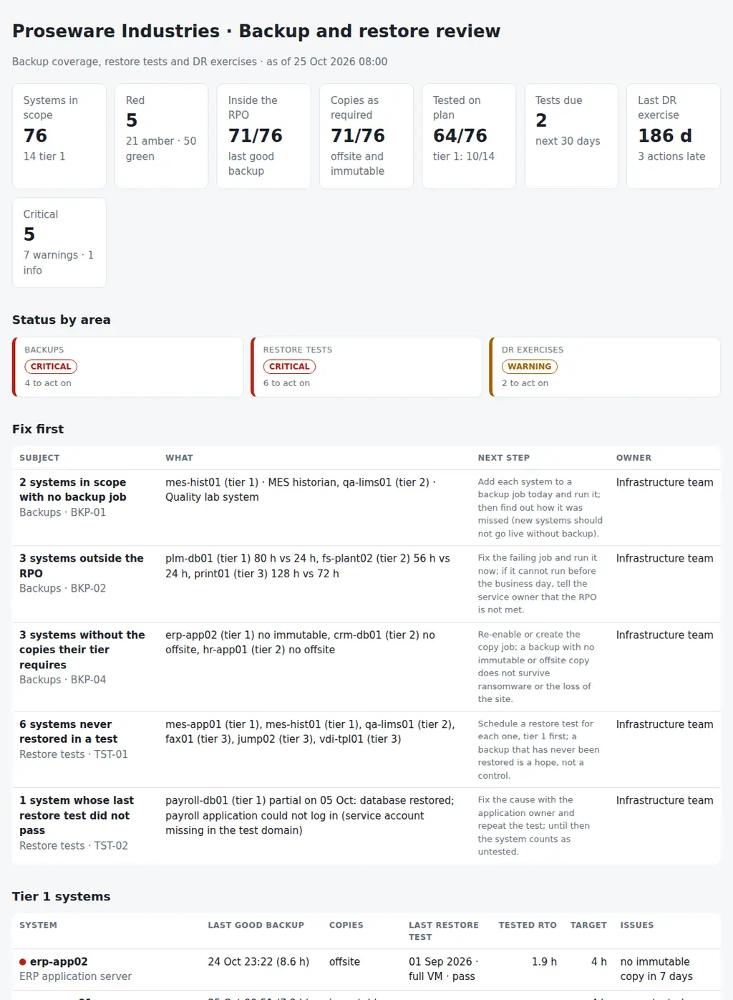

# Backup Restore Test Tracker

The monthly review of whether the backups would actually bring the systems back, built from the backup tools' own exports and the restore test register. It covers three areas:

- **Backups:** systems with no backup job, systems outside their RPO, jobs failing night after night, missing offsite or immutable copies, and jobs still running for systems that were retired.
- **Restore tests:** systems never restored in a test, last tests that failed or half worked, tests overdue against the plan, restores slower than the RTO, systems only ever tested with a file restore, and tests with no evidence.
- **DR exercises:** the last exercise, exercises planned and not done, and actions from past exercises still open after their due date.

A system register, the job log, the test register, two small DR files, one JSON with the rules and one Python command produce a red/amber/green view of every system and the agenda for the monthly review: **which systems could not be recovered as promised, why, and who fixes it.**

Python 3.10+, standard library only. It runs with fictional demo data out of the box. A read-only PowerShell exporter for Veeam Backup & Replication job sessions is included; other tools' job reports (Commvault, for example) work as CSV.



## Why

A green backup dashboard says the jobs ran. It does not say that the system can be brought back within the time the business was promised. The questions an auditor or a crisis asks are different:

- When was the last good backup of each tier 1 system, compared with its RPO? A job scheduled every night that failed three nights in a row is three days outside a 24-hour RPO.
- Is there a copy somewhere a ransomware attack cannot reach? A copy job that exists but has failed for a week does not count.
- When was each system last restored in a test, was it the whole system or one file, and how long did it take compared with the RTO?
- Where is the evidence of that test?
- Did the DR exercise planned for last month happen, and were its actions closed?

The answers live in the backup console, a spreadsheet of tests, the change tickets and the business continuity plan. This tool puts them side by side, per system and per tier, with the rule that flagged each line and the team that owns the fix. The rules are in `settings.json` and `restoretrack/checks.py`.

## What it checks

| Area | Code | Finding |
|---|---|---|
| Backups | BKP-01 | Systems in scope with no backup job in the log |
| Backups | BKP-02 | Last good backup older than the system's RPO |
| Backups | BKP-03 | `fail_streak` failed runs in a row, still inside the RPO |
| Backups | BKP-04 | Copies the tier requires (offsite, immutable) missing in the last `copy_window_days`; critical for a tier 1 system without an immutable copy |
| Backups | BKP-05 | Jobs for decommissioned, out-of-scope or unknown systems (for information, with the space they use) |
| Restore tests | TST-01 | Systems never restored in a test |
| Restore tests | TST-02 | Last restore test failed or only partly worked |
| Restore tests | TST-03 | Next test overdue against the tier's `test_days` or `full_test_days` |
| Restore tests | TST-04 | Tested restore slower than the RTO, or restored data older than the RPO |
| Restore tests | TST-05 | Only file or item restores, no full restore of the system |
| Restore tests | TST-06 | Tests in the last year with no evidence reference |
| DR exercises | DR-01 | No DR exercise within `dr_exercise_days` |
| DR exercises | DR-02 | Exercises planned and not done |
| DR exercises | DR-03 | Actions from exercises past their due date |

## Outputs

| File | What |
|---|---|
| `report.html` | Tiles, status by area, "Fix first", tier 1 systems, tier 2 and 3 systems with something to do, a 12-month calendar of tests due, DR exercises and open actions, all findings |
| `restore-review.md` | The agenda: summary, decisions as a checklist with owners, tier 1 at a glance, tests due in the next 30 days, the next DR exercise |
| `systems.csv` | Every system with its tier, RPO, RTO, last good backup, copies, last test, tested RTO and RPO, next test due, RAG status and issues |
| `tests-due.csv` | Restore tests due in the next 90 days or already overdue, with booked and done columns to fill in |
| `failing-backups.csv` | Systems with failed runs, missing copies or no backup, and what is wrong |
| `evidence-pack.csv` | The last successful test of every tier 1 and 2 system with its evidence reference, for the auditor |
| `dr-actions.csv` | DR exercise actions with owner, due date and status |
| `actions.csv`, `findings.csv` | The findings with owner and next step, ready for a tracker |

## Try it

```bash
git clone https://github.com/inigogonzalezgarcia/32-backup-restore-test-tracker.git
cd 32-backup-restore-test-tracker
python -m restoretrack demo
```

Open `output/report.html` and `output/restore-review.md`.

### The demo data

The demo is a made-up manufacturer, Proseware Industries, with 76 systems in scope: 14 tier 1 (ERP, MES, PLM, payroll, Active Directory, mail, the main file server, warehouse and EDI), 30 tier 2 and 32 tier 3. It has two weeks of job runs (about 2,000), a year of restore tests (165), four DR exercises and eight DR actions, reviewed on Sunday 25 October 2026 at 08:00.

The problems are placed on purpose:

- **Backups:**
  - the MES historian and the quality lab system were never added to a backup job;
  - the PLM database has failed three nights in a row and is 80 hours past a 24-hour RPO, and two smaller systems are outside theirs;
  - one ERP application server has had no immutable copy for 12 days, and two tier 2 systems have had no offsite copy for over a week;
  - two retired servers, a sandbox out of scope and an unknown test VM are still backed up, using 463 GB in two weeks.
- **Restore tests:**
  - six systems were never restored, two of them tier 1;
  - the last payroll test was partial: the database came back, but the application could not log in;
  - five tests are overdue, one of them tier 1;
  - the ERP database restore took 9.5 hours against a 4-hour RTO;
  - Active Directory and Microsoft 365 were only ever tested with object and item restores;
  - five tests have no evidence reference.
- **DR exercises:** the last annual failover was in November 2025, the ERP failover to Azure planned for 15 October did not happen, and three actions from earlier exercises are past their due date.

## Use it with your own backups

1. Export the job sessions (read-only, on the backup server or wherever the Veeam console is installed):
   ```powershell
   .\scripts\Export-VeeamJobs.ps1 -OutputFolder .\data -Days 14
   ```
   - The script only reads sessions; it does not start, stop or change jobs.
   - For other tools, export the job history as CSV and append it to the same file: the column names are matched loosely.
2. Add `systems.csv` (the register with tier, RPO and RTO per system), `restore_tests.csv`, `dr_exercises.csv` and `dr_actions.csv`.
3. Write `data/settings.json`: the test frequency and required copies per tier, and the owners ([docs/data-format.md](docs/data-format.md)).
4. Build the outputs:
   ```bash
   python -m restoretrack review data/ --title "Backup and restore review · November"
   ```

[docs/restore-review-runbook.md](docs/restore-review-runbook.md) has the 30-minute agenda, how to read each signal and what to do after the meeting.

The exports contain server names and infrastructure details. Keep them inside your organisation:

- real files at the top level (`systems*.csv`, `backup_jobs*.csv`, `restore_tests*.csv`, `dr_exercises*.csv`, `dr_actions*.csv`, `settings.json`, `data/`) and the `output/` folder are excluded from Git by `.gitignore`;
- only the fictional files in `sample_data/` are committed.

## Tests

```bash
pip install -r requirements-dev.txt
python -m pytest -q
```

GitHub Actions runs them on Python 3.10 and 3.12 on every push, then rebuilds the fictional sample data and the report screenshot from the simulator.

13 tests: the system register, job log and test register with other column names, accents, semicolons and decimal commas; settings and tiers; RPO and failure streaks; required copies by tier; orphan jobs and systems with no backup; the test plan, tested RTO from full restores only, partial tests and missing evidence; DR exercises and actions; and the demo end to end (deterministic, all nine outputs).

## Next steps

- Read the job sessions from the Veeam and Commvault REST APIs instead of an export, so the backup part can run every morning.
- Restore point immutability read from the repository settings instead of the job name.
- A per-owner extract, so each application owner receives the status and the tests due for their own systems.
- Trend over the last 12 reviews: systems inside the RPO, tests on plan and DR actions closed.

## Background

Built from my work with backup and recovery:

- Veeam Backup and Commvault, and tape backups earlier on;
- database backups, high availability and DR;
- designing and testing backup and DR plans;
- supervising DR and business continuity tests, aligned with ISO 22301.

Written from scratch with fictional data; no employer data, systems or exports are used.

## Customisation and contact

Want this adapted to your environment? For example:

- your backup tools and the way they report copy jobs and immutable repositories;
- your tiers, RPO and RTO targets and test frequencies;
- an evidence pack in the format your auditor asks for;
- the review written into your service desk or tracker each month.

Get in touch:

- Website (contact form): [inigogonzalezgarcia.github.io](https://inigogonzalezgarcia.github.io/about.html#contacto)
- LinkedIn: [linkedin.com/in/igonzalez93](https://www.linkedin.com/in/igonzalez93)

## License

MIT
